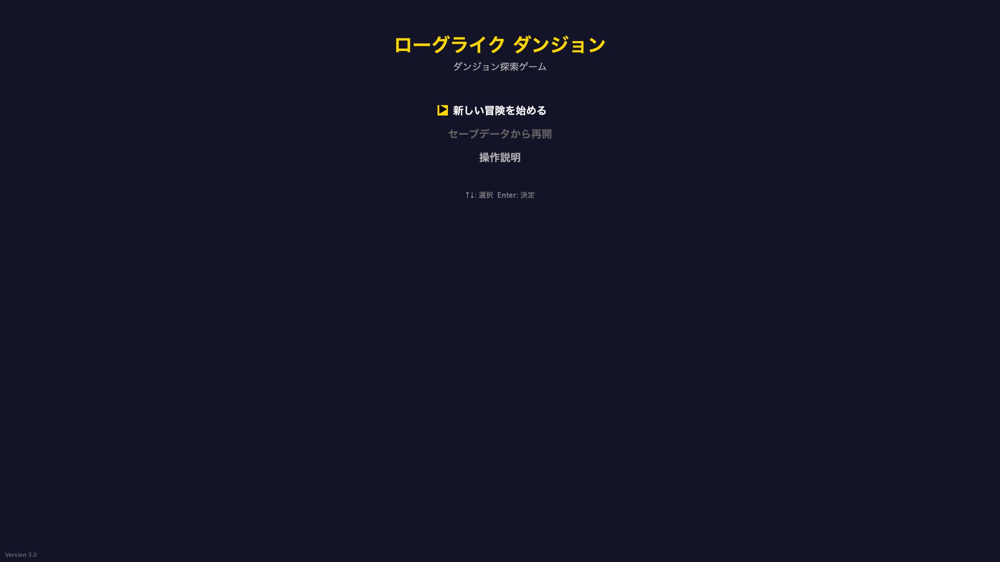
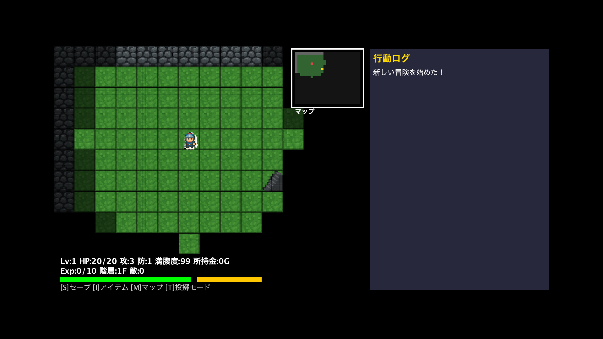
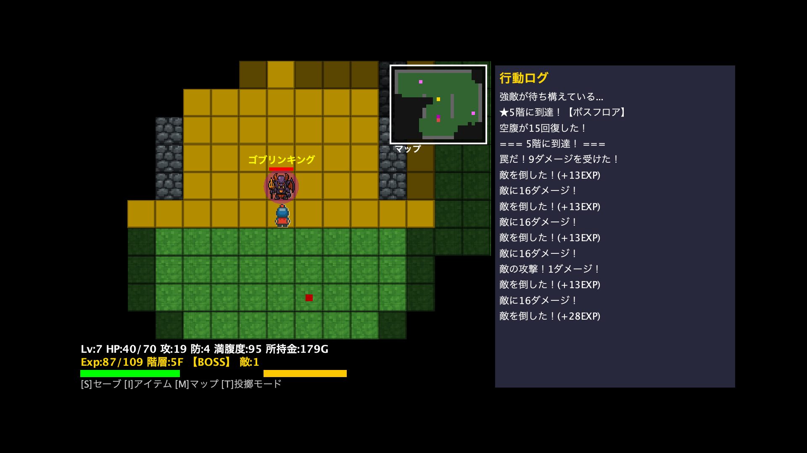

# Java ローグライク・ダンジョン探索ゲーム

Java Swing で作成した、キーボード操作の 2D ローグライクゲームです。ダンジョンを探索し、敵や罠に対処しながら全 50 階の踏破を目指します。デスクトップ向けの Java アプリケーションです。

## スクリーンショット

| タイトル画面 | ゲーム画面 | ボス戦 |
| --- | --- | --- |
|  |  |  |

## 制作の目的

Java のクラスやオブジェクト指向による責務分担を学ぶため、AI と対話しながら制作した学習用プロジェクトです。ゲームを作りながら、クラス、enum、コレクション、GUI、ファイル入出力などの使い方を学ぶことを目的としています。

## ゲームの仕様

- 25 x 20 マスのダンジョンを探索します。画面には一度に 15 x 10 マスが表示されます。
- 1 階から 50 階まで進みます。5 の倍数の階にはボスが登場します。
- 敵を倒して経験値を獲得し、レベルアップでプレイヤーを強化します。
- HP、攻撃力、防御力、空腹度を管理しながら探索します。
- アイテム、罠、ショップ、モンスターハウス、状態異常があります。
- セーブとロードに対応しています。セーブデータ `savegame.dat` はゲームの実行フォルダーに作成されます。
- マップ画像は `画像/` フォルダーから読み込みます。画像が読み込めない場合は図形で描画します。

## 操作方法

| キー | 操作 |
| --- | --- |
| `↑` `↓` `←` `→` | タイトル画面の選択、またはゲーム中の移動 |
| `Enter` | タイトル画面で決定、インベントリで選択 |
| `S` | セーブ |
| `I` | インベントリを開閉 |
| `T` | 投擲モードを切り替え |
| `M` | マップアイテム取得後に全体マップを切り替え |
| `Esc` | インベントリや操作説明を閉じる |

インベントリを開いた状態では、上下キーでアイテムを選び、`Enter` で使用します。ロードする場合はタイトル画面で上下キーを使って「ロード」を選び、`Enter` を押してください。

## 実行方法

JDK 17 以降を用意し、リポジトリのルートフォルダーで次のコマンドを実行します。

```bash
mkdir -p build
javac --release 8 -encoding UTF-8 -d build MoveGame_enemy.java core/*.java characters/*.java items/*.java effects/*.java traps/*.java ui/*.java
java -cp build MoveGame_enemy
```

画像を読み込むため、ゲームはリポジトリのルートフォルダーから起動してください。

## クラス構成

| ファイル | 役割 |
| --- | --- |
| `MoveGame_enemy.java` | Swing の画面、ゲーム状態、入力処理、ゲーム進行を管理するメインクラス |
| `core/GameState.java` | タイトル、プレイ中などのゲーム状態を表す enum |
| `core/ActionLog.java` | ゲーム内の行動ログを管理 |
| `characters/Enemy.java` | 通常敵の状態と行動を管理 |
| `characters/Boss.java` | ボスの状態と行動を管理 |
| `characters/EnemyType.java` | 敵の種類を表す enum |
| `characters/Direction.java` | キャラクターの向きを表す enum |
| `items/Item.java` | アイテムの基本情報を管理 |
| `items/ItemType.java` | アイテムの種類を表す enum |
| `items/ShopItem.java` | ショップで販売するアイテムを管理 |
| `items/ThrowableItem.java` | 投擲できるアイテムを管理 |
| `effects/StatusEffect.java` | 状態異常の種類を表す enum |
| `traps/Trap.java` | ダンジョン内の罠を管理 |
| `ui/GameScreens.java` | タイトル画面や案内画面の描画を担当 |

## リポジトリについて

このリポジトリはソースコードと画像素材を公開するものです。ゲームの実行には Java 環境が必要です。ブラウザー版や GitHub Pages での公開には対応していません。

## ライセンス

学習目的のプロジェクトです。利用や改変の際は、画像素材など各素材の利用条件を確認してください。